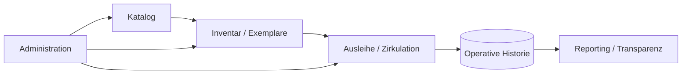

# Library Management System

### Katalog-, Bestands-, Ausleih- und Betriebsmanagement

<a href="./README.md">English</a> · <a href="./README.de.md"><strong>Deutsch</strong></a> · <a href="./README.tr.md">Türkçe</a>

  
  

---

## Überblick

Das Library Management System ist eine operative Plattform für Katalogdaten, physischen Bestand, Ausleihprozesse und administrative Transparenz.

Das Projekt behandelt eine Bibliothek als operatives System und nicht nur als Bücherdatenbank. Kataloginformationen, physische Exemplare, Ausleihstatus und historische Aktivitäten müssen konsistent zusammenarbeiten.

## Operatives Modell

## Kernfunktionen

| Bereich | Zweck |
|---|---|
| **Katalogverwaltung** | Bibliotheksressourcen und bibliografische Datensätze organisieren |
| **Bestandsverfolgung** | Transparenz über physische Exemplare und Bestand erhalten |
| **Zirkulation** | Ausleihe, Rückgabe und Ressourcenbewegungen unterstützen |
| **Historie** | Operativen Kontext über Zeit bewahren |
| **Administration** | Management-Workflows zentralisieren |
| **Suche & Transparenz** | Relevante Datensätze für Nutzer und Administratoren zugänglich machen |
| **Reporting** | Operative Datensätze in nutzbare Managementinformationen umwandeln |
| **Datenintegrität** | Bestand und Workflow-Zustände konsistent halten |

## Engineering-Fokus

Das Projekt konzentriert sich auf Konsistenzprobleme, die entstehen, wenn physischer Bestand und operative Historie synchron bleiben müssen.

Schwerpunkte:

- Domänenmodellierung
- Bestandszustand
- Workflow-Konsistenz
- Historische Datensätze
- Datenintegrität
- Administrative Prozesse
- Suche und Filterung
- Reporting
- Wartbare Anwendungsstruktur

## Daten & Datenschutz

Das öffentliche Repository stellt das System dar, ohne private operative Datensätze oder reale Nutzerdaten offenzulegen.

---

### Entwickelt von [Taha Kubilay](https://github.com/tahakubilay)

`Inventory Systems` · `Operational Software` · `Workflow Design` · `Data Modelling` · `Full-Stack Engineering`

