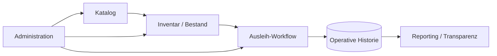

<div align="center">

# Library Management System

### Bestands-, Ausleih- und Betriebsmanagement für moderne Bibliotheksabläufe


<p><a href="./README.md">English</a> · <a href="./README.de.md"><strong>Deutsch</strong></a> · <a href="./README.tr.md">Türkçe</a></p>

<p>
<a href="https://github.com/tahakubilay"></a>
<a href="https://github.com/tahakubilay/library-management-system"></a>


</p>

</div>

---

## ✨ Auf einen Blick

| | |
|---|---|
| 📚 **Kerndomäne** | Bibliotheksbestand und Katalogverwaltung |
| 🔄 **Betrieb** | Ausleihe und tägliche operative Abläufe |
| 📦 **Inventar** | Bestandstransparenz und Sammlungsverfolgung |
| 🧑‍💼 **Administration** | Zentrale operative Verwaltung |
| 🧠 **Engineering** | Datenintegrität, Workflow-Modellierung und State-Konsistenz |
| 🚀 **Portfolio-Plan** | Screenshots, Demo-Daten und vollständige technische Dokumentation nach finaler Bereinigung |

> [!NOTE]
> Dieses Repository präsentiert das Projekt aktuell auf **Portfolio-Ebene**. Die finale technische Dokumentation wird direkt aus dem bereinigten Code erzeugt, damit Implementierungsdetails korrekt bleiben.

## 🔎 Überblick

Dieses Projekt ist als Bibliotheksbetriebssystem konzipiert, nicht als einfache Bücherdatenbank.

Die Plattform verbindet Kataloginformationen, physischen Bestand, Ausleih- und Rückgabeprozesse sowie administrative Transparenz in einer Umgebung.

Das Hauptziel ist, den physischen und operativen Zustand der Bibliothek leichter verständlich und verwaltbar zu machen.

## 💡 Kernkonzept

```text
Katalog
   ↓
Inventar / Exemplare
   ↓
Ausleihe / Zirkulation
   ↓
Operative Historie
   ↓
Administrative Transparenz
```

Dadurch entsteht ein konsistenter Fluss von dem, was die Bibliothek besitzt, bis dazu, wie Ressourcen verwendet und nachverfolgt werden.

## 🔄 High-Level-Operativer Ablauf



> [!IMPORTANT]
> Exakte Entitäten, Ausleihregeln, Berechtigungen, Datenbankbeziehungen und API-Flows werden aus dem finalisierten Code dokumentiert und nicht vorab geschätzt.

## ⚡ Kernfunktionen

| Bereich | Zweck |
|---|---|
| 📚 **Katalogverwaltung** | Bibliotheksressourcen und bibliografische Datensätze organisieren |
| 📦 **Bestandsverfolgung** | Transparenz über physische Exemplare und Bestand erhalten |
| 🔄 **Zirkulation** | Operative Bewegung von Bibliotheksressourcen unterstützen |
| 🧾 **Historie** | Nützlichen operativen Kontext über Zeit bewahren |
| 🧑‍💼 **Administration** | Management-Workflows zentralisieren |
| 🔎 **Suche & Transparenz** | Nutzern und Administratoren relevante Datensätze zugänglich machen |
| 📊 **Reporting** | Operative Daten in nutzbare Managementinformationen umwandeln |
| 🧱 **Datenintegrität** | Bestand und Workflow-Zustände konsistent halten |

## 🧠 Engineering-Fokus

Auch ein Bibliothekssystem wird komplex, sobald physischer Bestand und operative Historie synchron bleiben müssen.

Das Projekt zeigt Arbeit rund um:

- Domänenmodellierung
- Bestandszustand
- Workflow-Konsistenz
- Historische Datensätze
- Datenintegrität
- Administrative Prozesse
- Suche und Filterung
- Reporting
- Wartbare Anwendungsstruktur

## 🖼️ Produktvorschau

| Katalog | Inventar | Betrieb |
|---|---|---|
| 📚 Demnächst | 📦 Demnächst | 🔄 Demnächst |

Die finale Portfolio-Version wird enthalten:

- Reale Screenshots
- Kurzes Workflow-GIF
- Synthetische Katalogdaten
- Architekturdiagramme
- Datenbank-/Domänenmodell
- Demo-Anleitung

## 🚀 Demo

Nach Finalisierung kann eine portfolio-sichere Demo mit synthetischen Bibliotheksdaten veröffentlicht werden.

Die Demo wird reale Produktionsdatensätze vermeiden und repräsentative Workflows zeigen.

## 🛣️ Projektstatus

- [x] Öffentliches Portfolio-Repository
- [x] Produktpositionierung
- [x] High-Level-Operationsarchitektur
- [ ] Finale Codebereinigung
- [ ] Tatsächlichen Tech-Stack dokumentieren
- [ ] Screenshots ergänzen
- [ ] Workflow-GIF ergänzen
- [ ] Domänen-/Datenbankdiagramm ergänzen
- [ ] Installationsanleitung ergänzen
- [ ] Synthetische Demo-Daten ergänzen
- [ ] Öffentliche Demo deployen

## 💡 Warum dieses Projekt wichtig ist

Dieses Projekt zeigt, wie eine scheinbar einfache Domäne zu einem echten operativen System wird, sobald **Bestandszustand, Zirkulation und historische Konsistenz** gemeinsam funktionieren müssen.

`Inventory Systems` · `Operational Software` · `Workflow Design` · `Data Modelling` · `Full-Stack Engineering`

---

<div align="center">

### Entwickelt von [Taha Kubilay](https://github.com/tahakubilay)

</div>