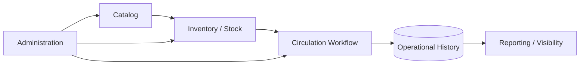

<div align="center">

# Library Management System

### Inventory, circulation and operational management for modern library workflows

<a href="https://github.com/tahakubilay/library-management-system">
  
</a>

<br/>

[](https://github.com/tahakubilay)
[](https://github.com/tahakubilay/library-management-system)
[](#-overview)
[](#-project-status)

<br/>


</div>

---

## ✨ At a Glance

| | |
|---|---|
| 📚 **Core Domain** | Library inventory and catalog management |
| 🔄 **Operations** | Circulation and day-to-day workflows |
| 📦 **Inventory** | Stock visibility and collection tracking |
| 🧑‍💼 **Administration** | Centralized operational management |
| 🧠 **Engineering** | Data integrity, workflow modelling and state consistency |
| 🚀 **Portfolio Plan** | Screenshots, demo data and full technical documentation after final cleanup |

> [!NOTE]
> This repository currently presents the project at **portfolio level**. The final technical documentation will be generated from the cleaned codebase so implementation details stay accurate.

## 🧭 Quick Navigation

[Overview](#-overview) • [Operational Flow](#-high-level-operational-flow) • [Capabilities](#-core-capabilities) • [Engineering](#-engineering-focus) • [Roadmap](#-project-status)

## 🔎 Overview

This project is designed as a library operations system rather than a simple book database.

The platform brings together catalog information, stock state, circulation-related workflows and administrative visibility in one environment.

The main goal is to make the library's physical and operational state easier to understand and manage.

## 💡 Core Concept

```text
Catalog
   ↓
Inventory / Copies
   ↓
Circulation
   ↓
Operational History
   ↓
Administrative Visibility
```

This creates a consistent flow from what the library owns to how those resources are used and tracked.

## 🔄 High-Level Operational Flow



> [!IMPORTANT]
> Exact entities, lending rules, permissions, database relationships and API flows will be documented from the finalized codebase rather than guessed in advance.

## ⚡ Core Capabilities

| Area | Purpose |
|---|---|
| 📚 **Catalog Management** | Organize library resources and bibliographic records |
| 📦 **Inventory Tracking** | Maintain visibility into physical stock / copies |
| 🔄 **Circulation** | Support operational movement of library resources |
| 🧾 **History** | Preserve useful operational context over time |
| 🧑‍💼 **Administration** | Centralize management workflows |
| 🔎 **Search & Visibility** | Help users and administrators find relevant records |
| 📊 **Reporting** | Turn operational data into usable management insight |
| 🧱 **Data Integrity** | Keep stock and workflow state consistent |

## 🧠 Engineering Focus

Even a library system becomes complex when physical inventory and operational history need to remain synchronized.

The project highlights work around:

- Domain modelling
- Inventory state
- Workflow consistency
- Historical records
- Data integrity
- Administrative processes
- Search and filtering
- Reporting
- Maintainable application structure

## 🖼️ Product Showcase

| Catalog | Inventory | Operations |
|---|---|---|
| 📚 Coming soon | 📦 Coming soon | 🔄 Coming soon |

The final portfolio version will include:

- Real screenshots
- Short workflow GIF
- Example synthetic catalog data
- Architecture diagrams
- Database / domain model
- Demo instructions

## 🚀 Demo

A portfolio-safe demo can be published with synthetic library data after the application is finalized.

The demo will avoid real production records and focus on representative workflows.

## 🛣️ Project Status

- [x] Public portfolio repository
- [x] Product positioning
- [x] High-level operational architecture
- [ ] Final code cleanup
- [ ] Document real technology stack
- [ ] Add screenshots
- [ ] Add workflow GIF
- [ ] Add domain / database diagram
- [ ] Add installation guide
- [ ] Add synthetic demo data
- [ ] Deploy public demo

## 💡 Why This Project Matters

This project demonstrates how an apparently straightforward domain becomes a real operational system once **inventory state, circulation and historical consistency** have to work together.

It represents experience across:

`Inventory Systems` · `Operational Software` · `Workflow Design` · `Data Modelling` · `Full-Stack Engineering`

---

<div align="center">

### Built by [Taha Kubilay](https://github.com/tahakubilay)

**Software Engineer · Full-Stack Systems · Operational Software**

[⬆ Back to top](#library-management-system)

</div>