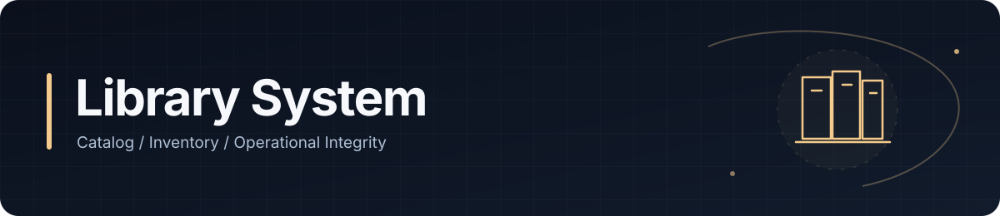
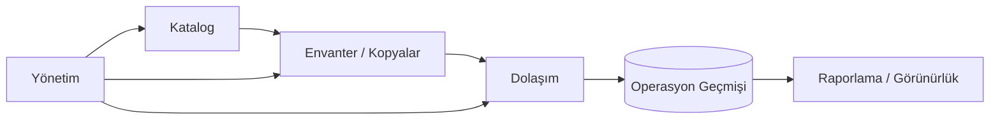

# Kütüphane Yönetim Sistemi

### Katalog, envanter, dolaşım ve operasyon yönetimi

<a href="./README.md">English</a> · <a href="./README.de.md">Deutsch</a> · <a href="./README.tr.md"><strong>Türkçe</strong></a>

  
  

---

## Genel Bakış

Kütüphane Yönetim Sistemi; katalog kayıtlarını, fiziksel envanteri, dolaşım workflow'larını ve yönetim görünürlüğünü tek yapıda birleştiren operasyonel bir platformdur.

Proje kütüphaneyi basit bir kitap veritabanı olarak değil, operasyonel bir sistem olarak ele alır. Katalog bilgileri, fiziksel kopyalar, dolaşım state'i ve geçmiş hareketler birbiriyle tutarlı kalmalıdır.

## Operasyon Modeli

## Temel Yetenekler

| Alan | Amaç |
|---|---|
| **Katalog Yönetimi** | Kütüphane kaynaklarını ve bibliyografik kayıtları düzenlemek |
| **Envanter Takibi** | Fiziksel kopya ve stok görünürlüğünü korumak |
| **Dolaşım** | Ödünç verme, iade ve kaynak hareketlerini desteklemek |
| **Geçmiş** | Zaman içinde operasyonel bağlamı korumak |
| **Yönetim** | Yönetim workflow'larını merkezileştirmek |
| **Arama & Görünürlük** | İlgili kayıtları kullanıcı ve yöneticiler için erişilebilir kılmak |
| **Raporlama** | Operasyonel kayıtları yönetim bilgisine dönüştürmek |
| **Veri Bütünlüğü** | Envanter ve workflow state'ini tutarlı tutmak |

## Mühendislik Odağı

Proje, fiziksel envanter ile operasyon geçmişinin senkron kalması gerektiğinde ortaya çıkan tutarlılık problemlerine odaklanır.

Başlıca konular:

- Domain modelleme
- Envanter state'i
- Workflow tutarlılığı
- Geçmiş kayıtları
- Veri bütünlüğü
- Yönetim süreçleri
- Arama ve filtreleme
- Raporlama
- Sürdürülebilir uygulama yapısı

## Veri & Gizlilik

Public repository, özel operasyon kayıtlarını veya gerçek kullanıcı verilerini açığa çıkarmadan sistemi temsil edecek şekilde tutulur.

---

### Geliştiren: [Taha Kubilay](https://github.com/tahakubilay)

`Inventory Systems` · `Operational Software` · `Workflow Design` · `Data Modelling` · `Full-Stack Engineering`

