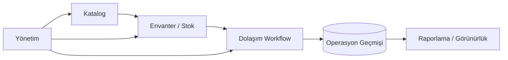

<div align="center">

# Kütüphane Yönetim Sistemi

### Modern kütüphane workflow'ları için envanter, dolaşım ve operasyon yönetimi


<p><a href="./README.md">English</a> · <a href="./README.de.md">Deutsch</a> · <a href="./README.tr.md"><strong>Türkçe</strong></a></p>

<p>
<a href="https://github.com/tahakubilay"></a>
<a href="https://github.com/tahakubilay/library-management-system"></a>


</p>

</div>

---

## ✨ Kısaca

| | |
|---|---|
| 📚 **Ana Domain** | Kütüphane envanteri ve katalog yönetimi |
| 🔄 **Operasyonlar** | Dolaşım ve günlük iş akışları |
| 📦 **Envanter** | Stok görünürlüğü ve koleksiyon takibi |
| 🧑‍💼 **Yönetim** | Merkezi operasyon yönetimi |
| 🧠 **Mühendislik** | Veri bütünlüğü, workflow modelleme ve state tutarlılığı |
| 🚀 **Portföy Planı** | Final temizlik sonrası ekran görüntüleri, demo verileri ve tam teknik dokümantasyon |

> [!NOTE]
> Bu repo projeyi şu an **portföy seviyesinde** sunar. Final teknik dokümantasyon, implementasyon detayları doğru kalsın diye temizlenmiş kod tabanından üretilecektir.

## 🔎 Genel Bakış

Bu proje basit bir kitap veritabanı değil, bir kütüphane operasyon sistemi olarak tasarlanmıştır.

Platform; katalog bilgisini, stok durumunu, dolaşım workflow'larını ve yönetim görünürlüğünü tek bir ortamda bir araya getirir.

Ana amaç, kütüphanenin fiziksel ve operasyonel durumunu daha kolay anlaşılır ve yönetilebilir hale getirmektir.

## 💡 Temel Konsept

```text
Katalog
   ↓
Envanter / Kopyalar
   ↓
Dolaşım
   ↓
Operasyon Geçmişi
   ↓
Yönetim Görünürlüğü
```

Bu yapı, kütüphanenin sahip olduğu kaynaklardan bu kaynakların nasıl kullanıldığı ve takip edildiğine kadar tutarlı bir akış oluşturur.

## 🔄 Yüksek Seviye Operasyon Akışı



> [!IMPORTANT]
> Kesin entity'ler, ödünç verme kuralları, izinler, veritabanı ilişkileri ve API akışları önceden tahmin edilmek yerine finalize edilmiş kod tabanından belgelenecektir.

## ⚡ Temel Yetenekler

| Alan | Amaç |
|---|---|
| 📚 **Katalog Yönetimi** | Kütüphane kaynaklarını ve bibliyografik kayıtları düzenlemek |
| 📦 **Envanter Takibi** | Fiziksel stok / kopya görünürlüğünü korumak |
| 🔄 **Dolaşım** | Kütüphane kaynaklarının operasyonel hareketini desteklemek |
| 🧾 **Geçmiş** | Zaman içinde faydalı operasyonel bağlamı korumak |
| 🧑‍💼 **Yönetim** | Yönetim workflow'larını merkezileştirmek |
| 🔎 **Arama & Görünürlük** | Kullanıcıların ve yöneticilerin ilgili kayıtlara ulaşmasını kolaylaştırmak |
| 📊 **Raporlama** | Operasyonel veriyi kullanılabilir yönetim içgörüsüne dönüştürmek |
| 🧱 **Veri Bütünlüğü** | Stok ve workflow state'ini tutarlı tutmak |

## 🧠 Mühendislik Odağı

Fiziksel envanter ve operasyon geçmişi senkron kalmak zorunda olduğunda kütüphane sistemi de ciddi biçimde karmaşıklaşır.

Projenin öne çıkardığı alanlar:

- Domain modelleme
- Envanter state'i
- Workflow tutarlılığı
- Geçmiş kayıtları
- Veri bütünlüğü
- Yönetim süreçleri
- Arama ve filtreleme
- Raporlama
- Sürdürülebilir uygulama yapısı

## 🖼️ Ürün Vitrini

| Katalog | Envanter | Operasyonlar |
|---|---|---|
| 📚 Yakında | 📦 Yakında | 🔄 Yakında |

Final portföy sürümü şunları içerecektir:

- Gerçek ekran görüntüleri
- Kısa workflow GIF'i
- Örnek sentetik katalog verileri
- Mimari diyagramlar
- Veritabanı / domain modeli
- Demo talimatları

## 🚀 Demo

Uygulama finalize edildikten sonra sentetik kütüphane verileriyle portföye güvenli bir demo yayınlanabilir.

Demo gerçek production kayıtlarını kullanmayacak ve örnek workflow'lara odaklanacaktır.

## 🛣️ Proje Durumu

- [x] Public portföy reposu
- [x] Ürün konumlandırması
- [x] Yüksek seviye operasyon mimarisi
- [ ] Final kod temizliği
- [ ] Gerçek teknoloji yığınını belgele
- [ ] Ekran görüntülerini ekle
- [ ] Workflow GIF'ini ekle
- [ ] Domain / veritabanı diyagramını ekle
- [ ] Kurulum rehberi ekle
- [ ] Sentetik demo verilerini ekle
- [ ] Public demoyu deploy et

## 💡 Bu Proje Neden Önemli?

Bu proje, görünürde basit bir domainin **envanter state'i, dolaşım ve tarihsel tutarlılık** birlikte çalışmak zorunda olduğunda nasıl gerçek bir operasyon sistemine dönüştüğünü gösterir.

`Inventory Systems` · `Operational Software` · `Workflow Design` · `Data Modelling` · `Full-Stack Engineering`

---

<div align="center">

### Geliştiren: [Taha Kubilay](https://github.com/tahakubilay)

</div>